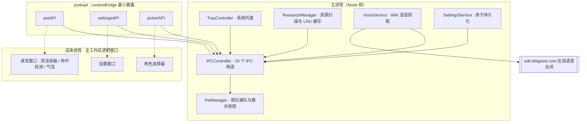

# 碧蓝航线桌宠 (blyy-pet)

<p align="center">
  <b>碧蓝航线 SD 小人 · Windows 11 桌面宠物</b><br>
  Electron 33 · Spine 3.8 · WebGL 批量渲染 · 逐像素鼠标穿透
</p>

碧蓝航线（Azur Lane）SD 小人桌宠：支持**舰队编队**（最多 3 只同屏）、**桌面散步**、**逐像素鼠标命中穿透**与**在线语音台词**。自研 Spine WebGL 批量渲染管线，实测每帧绘制 0.16ms，较 Canvas2D 提升约 **67 倍**。内置示例角色开箱即用，也可加载自备 SD 资源，覆盖 1500+ 舰娘。

> [!NOTE]
> 本仓库为**项目文档仓库**，仅包含说明文档与许可证，暂未公开源代码。

[](LICENSE)


---

## ✨ 功能一览

### 桌宠与交互

- **透明置顶显示** — Spine SD 小人驻留于桌面工作区，可选「始终前台」（`screen-saver` 级置顶，可覆盖全屏应用）。窗口**不可聚焦**：点击桌宠不会从前台应用（游戏/编辑器）夺走键盘焦点。
- **逐像素鼠标命中** — 窗口透明区域点击直达下层程序，仅角色本体、台词气泡与错误提示可交互；按光标下像素 alpha 滞回切换穿透状态（进入 16 / 退出 6），无死区也无误拦。命中求值**零 GPU 回读**：渲染器绘制时捕获帧几何，命中时以重心坐标 + 图集 alpha 采样 + 混合方程纯 CPU 求值（与帧缓冲合成结果一致），消除 `readPixels` 的管线同步点。判定逻辑收敛为纯函数状态机 `HitTestPolicy`（模式 → 菜单 → 拖拽 → 光标有效性 → 错误浮层 → 气泡 → 像素 alpha → 穿透），带 **90ms 翻转抑制**：抑制只作用于"边缘像素抖动"这类几何判定，模式切换/菜单/拖拽/无光标等确定性事件立即生效，且抑制期间不丢状态、下一帧重判。穿透态光标由**主进程单例采样器** `PointerTracker` 驱动（一次 `screen.getCursorScreenPoint` 服务全部桌宠；光标逼近热区 16ms、远离 90ms、热区内静止 120ms 心跳），`setIgnoreMouseEvents` 的 `forward` 转发在部分环境恒 0 事件（实测 Windows 11 预览版 + Electron 33），采样因此是穿透态唯一的坐标来源；渲染端 `CursorTracker` 对"真实事件 / 主进程采样"两个来源各自校验寿命（900ms / 240ms）后取更新者，杜绝旧实现里"采样坐标永不判定过期"导致的冻结光标。**全局穿透是主进程权威态**：模式开启期间任何"转交互"请求一律丢弃（模式推送与判定帧交错时的过期 `false` 不会吃掉一块工作区）；主进程因崩溃/无响应/重载强制回穿透时会回灌 `SYNC_IGNORE_STATE` 同步渲染端基线，避免"渲染端以为自己仍是交互态 → 同态去重 → 永不再下发"的单向失同步。
- **点击互动** — 左键点击随机播放动作与语音台词；拖动播放专属拖拽动画。
- **自由拖动** — 拖拽在画布内完成，窗口本身永不移动（见[渲染架构](#-渲染架构性能核心)）。拖拽链路经**指针捕获**（Pointer Capture）：光标越过窗口边界（任务栏/相邻显示器）拖拽不中断；角色可拖至屏幕边缘乃至部分出画（中心保持在屏内，约半身始终可见可抓回）。
- **右键菜单** — 本体设置（播放动作/语音、缩放 0.5×–2.0×、切换角色、重载）+ 全局设置（始终前台 / 散步 / 穿透 / 开机自启）。

### 舰队编队与桌面散步

- **舰队编队** — 最多 **3** 只桌宠同屏，每只独立角色 / 皮肤 / 缩放 / 位置；在角色选择器内添加、移除成员或定向指派角色。
- **桌面散步** — 每 **1–3 分钟**随机触发一次，小人在屏幕内自然滑行约 2.6 秒（水平 180–420px、垂直浮动 ±48px）；最近一次交互后静默 30 秒，可全局开关。**移动朝向正确**：SD 移动动画为左向美术（逐帧渲染实证），右移时自动水平镜像骨骼（`scaleX=-1`，同步补偿定位矩阵与包围盒中心），左移原样播放——杜绝"倒着走"；动画按 `move > walk > run > swim` 优先级选取（泳装角色回退 swim）。

### 语音与台词

- **在线语音台词** — 从碧蓝航线 Wiki（biligame）在线抓取台词与音频流式播放；皮肤目录内的本地音频（.mp3/.wav/.ogg）优先使用。
- **智能名称匹配** — VoiceMatcher 级联匹配「资源代码 ↔ 舰娘名」（精确 → 软/硬变体后缀 → 前缀 → 模糊子串 + 手动映射 + 多音字覆盖），**998 个舰名全量回归测试**保证不会播错人的语音（META / 改造 / μ兵装 等变体不回退到基础舰娘）。
- **多级缓存** — 内存 LRU（50 条）+ 磁盘缓存（上限 400 文件、7 天有效）+ 拼音映射表（30 天）；断网退避、并发去重，不重复请求。

### 版本更新与资源下载

- **启动自动检查更新** — 启动 4 秒后静默查询 GitHub Releases（无鉴权、失败静默不打扰），发现新版本自动弹出更新窗口；可在设置中关闭或「跳过此版本」。
- **更新日志** — 以 Releases 的 tag / 发布日期 / 正文作为更新日志展示（极简 Markdown 渲染，支持标题、列表、粗体与行内代码）。
- **双渠道下载** — GitHub 直链（自动挑选安装包 `*-setup.exe` 附件，兼容旧版本 `*-portable.exe`）/ GitHub 发布页 / 夸克网盘（打开时自动复制提取码）；GitHub 接口不可达时仍可经夸克网盘兜底获取。
- **SD 资源一键导入** — 设置窗口内置夸克网盘资源包入口（链接 + 提取码一键复制）：ZIP 压缩包经 PowerShell 解压后自动探测资源结构（兼容包装目录）合并进资源目录；已解压目录可直接设为资源目录；首次导入自动种子复制内置示例角色。

### 窗口与韧性

- **角色选择器** — 1500+ 舰娘拼音代码即时搜索（增量过滤，万级条目不卡顿），Enter 直达唯一结果（多皮肤时展开皮肤列表）。
- **设置窗口** — 缩放（0.3×–2.0×，右键菜单预设 0.5×–2.0×）/ 语音 / 音量 / 自动播放 / 台词气泡 / 桌面散步 / 触摸穿透 / 始终前台 / 开机自启 / 资源目录，一应俱全。
- **显示器热插拔** — 移除或更改显示器后成员位置自动回迁主屏。
- **崩溃自恢复** — 渲染进程异常退出自动重载重建。
- **单实例锁** — 重复启动直接唤起已有桌宠，不重复驻留。

## 🎨 界面主题

「御窑青花」（明永乐·宣德青花瓷）主题：苏麻离青钴蓝色阶、甜白釉底色、朱砂警示红。设置窗口以纯 SVG 绘制瓶形外框、回纹饰带、海水江崖纹页脚；字体使用系统回退链，**零外部 CDN 依赖**，离线可用。

## 🚀 渲染架构（性能核心）

### 全工作区窗口 + 画布内移动

桌宠窗口覆盖所在显示器**整个工作区，创建后永不移动、永不缩放**（仅显示器拓扑变化时按新工作区重贴）；拖拽与散步都是移动画布内的小人。从根源上消除了 Electron 透明窗口高频 `setPosition` 与重绘交错导致的移动闪烁，桌面散步期间零窗口系统调用。

配合**帧级包围盒**（角色 ∪ 气泡矩形）约束清屏、scissor 与命中读取，GPU 带宽从整屏降至约 300×400 区域。

### 双渲染器管线

|  | WebGL 批量渲染（默认） | Canvas2D（回退） |
| --- | --- | --- |
| 绘制方式 | 整帧三角形合并 VBO/IBO，**个位数 draw call** | 逐三角形 `clip` + `drawImage`（600+ 次/帧） |
| 实测每帧绘制 | **0.156ms**（p95 0.3ms） | 10.4ms（p95 18.3ms），慢约 **67×** |
| 拼接缝 | GPU 三角形光栅化，共享边**天然无缝** | 亚像素外扩补偿（见下） |
| 混合 | PMA 预乘 alpha，4 种混合方程与官方 spine-webgl 3.8 一致 | — |

> 实测基准：635 三角形 SD 角色，`probe:seam --bench 1`（avg / p50 / p95 / max、draw call、三角形数全套统计）。

- **拼接缝修复**：Canvas2D 逐三角形 clip 的抗锯齿会在共享边两侧各留约半像素透明缝隙，深色立绘上呈白色网状裂纹。本项目的 Canvas2D 运行时增补了外扩补偿——网格内部共享边外扩 0.75px、轮廓边界外扩 0.5px（按设备像素换算），并限制尖锐针形三角形的位移上限、半透明期间自动停用，避免衍生黑边与闪线。
- **渲染兜底**：WebGL 初始化失败自动回退 Canvas2D；无 GPU 设备上 Chromium 会以 SwiftShader 软件渲染继续跑 WebGL，批量管线仍显著快于 Canvas2D。
- **帧率分层**：待机 / 散步 30fps，拖动与动作播放 60fps，兼顾功耗与流畅。
- **零回读命中检测**：WebGL 渲染器 `draw` 遍历插槽时顺带把实际绘制的三角形（设备像素坐标 + UV + 槽位 alpha + 混合模式）捕获进预分配缓冲；命中检测按绘制顺序做 bbox 预筛 + 重心坐标包含测试 + 图集 alpha 采样，并按混合方程累积 alpha（Normal/Additive/Multiply/Screen 各自的帧缓冲语义），结果与 `readPixels` 读帧缓冲一致，但不产生任何 GPU 管线同步——光标在角色上移动时每帧的 `readPixels` 阻塞彻底归零，且逐帧求值让 idle 呼吸边缘的穿透/交互切换当帧响应。

### 架构总览



## 🔒 安全设计

- 渲染进程 `contextIsolation: true`、`nodeIntegration: false`；三个窗口各自**最小化暴露** preload API。
- 设置写入**白名单**（17 个键）+ 类型 / 范围校验，防止渲染进程注入任意键、畸形值反复写盘。
- 资源文件读取限定在资源根目录内（路径归一化校验，防 `../` 逃逸）。
- CSP：`media-src` 仅放行本地资源与 `https://*.biligame.com`，脚本与样式全部本地，无外部 CDN。
- 禁止 `window.open` 与任意页面导航；单实例锁。
- Wiki 抓取：响应体 16MB 上限（防压缩炸弹）、重定向拒绝跨域、25 秒超时、keep-alive 连接池。
- 设置文件**原子写入**（临时文件 + rename），异常断电不损坏配置。

## 📦 获取与使用

### 环境要求

- Windows 10 / 11（x64），针对 Windows 11 优化
- 打包版无需任何运行时依赖

### 使用步骤

1. 获取 `blyy-pet-<版本号>-setup.exe`（Releases 附件，标准安装包；也可下 `blyy-pet-<版本号>-x64.zip` 免安装解压即用，或按下一节自行构建）。
2. 双击安装。向导是中文标准安装流程，共三步：
   - **安装选项**：选「仅为我安装」或「为使用这台电脑的任何人安装」（后者用管理员权限装到 `Program Files`）；
   - **选定安装位置**：默认 `%LOCALAPPDATA%\Programs\blyy-pet`，点「浏览(B)...」可装到任意目录（如 `D:\Games\blyy-pet`）；升级/重装会自动沿用上次选的目录；
   - **安装**：自动创建桌面与开始菜单快捷方式，完成后可直接勾选运行。
   内置示例角色「阿尔萨斯」（3 套皮肤）随安装包分发，启动即见，**开箱即用**，无需任何配置。
3. 右键托盘图标 → 设置 → 「资源 · 下载舰娘 SD 资源」，从夸克网盘下载全量资源包后一键导入（ZIP 或已解压目录均可）；也可手动选择任意资源目录。
4. 右键桌宠本体或托盘图标，体验编队、散步、穿透、检查更新等完整功能。

> 卸载：设置 → 应用 → 「碧蓝航线桌宠」→ 卸载（或运行安装目录下的 `Uninstall 碧蓝航线桌宠.exe`）。默认保留 `%APPDATA%\blyy-pet` 下的设置与日志，重装后配置不丢。

### SD 资源目录结构

与安卓端 blhx_sd 资源结构一致，每套皮肤为标准 Spine 三件套：

```
<你的资源目录>/
└── aersasi/                 # 舰娘拼音代码
    ├── default/             # 默认皮肤
    │   ├── aersasi.skel     # 骨骼数据
    │   ├── aersasi.atlas    # 图集描述
    │   └── aersasi.png      # 纹理图集
    ├── gai/                 # 改造皮肤
    ├── huan/                # 换装皮肤
    └── skin2/ … skin4/      # 其他编号皮肤
```

皮肤目录命名支持 `default` / `gai`（改造）/ `huan`（换装）/ `skin2`–`skin4` 等，文件名自动探测匹配。资源根解析优先级：用户指定目录 → 打包内置资源（`resources/blhx_sd`）→ **asar 内嵌示例资源**（`app.asar/assets/sample-sd`）→ 开发目录（`build/bundled_sd`、`sd/organized`）→ 用户数据目录（自动创建）。

内置示例角色做了**双副本冗余**：同一份 `build/bundled_sd` 既作为散装目录 `resources/blhx_sd`（便于直观查看/替换），又打进 `app.asar` 的 `assets/sample-sd`。散装目录被杀软隔离、被清理工具误删、或只拷贝了 `app.asar` 而漏掉 `resources` 时，会自动回落到 asar 内副本——因此「装完却一个小人都没有」这种情况不会发生。

通过设置窗口导入资源时无需手工整理：ZIP 压缩包会解压合并进资源目录（自动识别压缩包内的包装目录），已解压的目录则直接作为资源目录使用；导入完成后自动重建 1500+ 角色索引。7z / rar 暂不支持直接解压，请先手动解压再导入目录。

## 🛠️ 本地开发与构建

> 本仓库仅包含文档；以下为源码形态下的开发流程，供参考。

环境要求：Node.js ≥ 18、npm。

```bash
# 1. 安装依赖（国内网络建议设置镜像）
export ELECTRON_MIRROR=https://npmmirror.com/mirrors/electron/
npm install

# 2. 开发运行
npm start          # 正常启动
npm run dev        # 带控制台日志启动

# 3. 打包（输出 dist/blyy-pet-<版本号>-setup.exe 安装包 与 dist/blyy-pet-<版本号>-x64.zip 免安装包）
export ELECTRON_CACHE="$PWD/.electron-cache"   # Electron 下载缓存收进项目内
npm run build

#    若在受管控环境（安全软件/Sandbox 会拦截"在项目目录内执行新生成的 exe"）下构建 NSIS 卸载器失败，
#    把输出目录改到工作区之外即可：
npx electron-builder --win --config.directories.output="%TEMP%/blyy-dist"

# 4. 打包国内镜像（electron-builder 二进制）
export ELECTRON_BUILDER_BINARIES_MIRROR=https://npmmirror.com/mirrors/electron-builder-binaries/

打包配置要点（踩过的坑，已固化在仓库里）：

- **安装包形态**：`nsis`（`oneClick:false` + `allowToChangeInstallationDirectory:true` + `perMachine:false` + `allowElevation:true`）→ 中文三步向导：安装选项（当前用户/所有用户）→ 选定安装位置（可浏览改目录）→ 安装；`artifactName` 用 ASCII（`blyy-pet-<版本号>-setup.exe`），中文文件名会触发部分安全软件注入导致安装器崩溃。
- **内置示例角色双副本**：`build/bundled_sd` 既通过 `extraResources` 落到 `resources/blhx_sd`，又通过 `files` 映射进 asar 的 `assets/sample-sd`（`{"from": "build/bundled_sd", "to": "assets/sample-sd"}`），后者是资源被隔离/误删时的兜底。
- **`build/installer.nsh` 必须存为 UTF-8 with BOM**：无 BOM 时 NSIS 按 ANSI 解析，中文注释会让宏体解析异常、`CreateShortCut` 静默失败；脚本里用字面量路径兜底（electron-builder 25 在 `customInstall` 阶段 `$appExe` 可能为空）。
- **卸载器阶段会执行刚生成的 setup.exe**：在"禁止在工作区执行新建 exe"的受管控环境里必须把 `--config.directories.output` 指到工作区之外，否则 `BUILD_UNINSTALLER` 失败（`Exit code: 2`）。
```

一键启动脚本：`start.bat`（双击运行，缺依赖时自动经国内镜像安装）、`start.ps1`（PowerShell 入口）、`launch.ps1`（隐藏窗口分离启动，日志写入 `launch.log`）。

## 🧪 测试与质量保障

- **`npm test`** — 七套离线单元测试（无 Electron 依赖，纯 Node 直跑）：
  - VoiceMatcher 全量回归：998 个 Wiki 舰名 × 1095 个资源代码快照，断言正确匹配 + 误配防护（赤城 不得命中 赤城·META / μ兵装 / 小赤城 等）。
  - UpdateService：版本号比对 / Releases 解析（draft 过滤、预发布排序）/ 直链附件挑选 / 网络错误文案映射。
  - ResourceImportService：资源根探测（标准结构、包装目录、杂项混入）/ 合并搬移（目录合并、文件覆盖、同名冲突）/ 写权限探测。
  - WalkAnimPicker：移动动画挑选（优先级排序、泳装/无变体回退）与朝向镜像决策（右移镜像/左移原样）。
  - HitTestPolicy：命中状态机 20 组断言——判定优先级、alpha 滞回、90ms 抑制只拦几何抖动、抑制期间不丢状态、浮层参与、光标源过期即视为不可用。
  - CursorTracker：双光标源 14 组断言——各自寿命、过期降级、新鲜者优先、`mouseout` 立即作废、`reset` 清空。
  - PointerTracker：主进程采样器 24 组断言——单次采样服务多订阅者、热区/远离自适应节拍、静止心跳、变化立即投递、异常退避不丢订阅、退订幂等与自动停机。
- **六个端到端探针**（复用完整应用实例，断言日志、持久化与窗口状态；命中类探针经 PowerShell 驱动**真实光标**，因为合成事件会被主进程采样心跳按时间戳覆盖）：

  | 探针 | 验证内容 |
  | --- | --- |
  | `probe:walk` | 散步期间窗口位置零移动、小人新位置正确持久化、移动动画与位移方向对应 |
  | `probe:fleet` | 编队成员添加 / 移除 / 定向指派的完整链路 |
  | `probe:hit` | 逐像素命中状态机：初始整窗穿透、角色像素可交互、空白区穿透、状态可逆、拖动恒交互、气泡可交互、右键菜单整窗穿透 |
  | `probe:voice` | 语音播放端到端：`play()` 无异常、气泡尺寸封顶 |
  | `probe:passthrough` | 全局触摸穿透开关：开启时扫过角色零切换、关闭后逐像素命中恢复 |
  | `probe:seam` | 渲染基准测试 + Canvas2D 外扩几何自测 |

## 📐 代码规模与技术栈

| 维度 | 说明 |
| --- | --- |
| 运行框架 | Electron 33 · Node.js ≥ 18 |
| 渲染 | Spine 3.8 运行时（vendored）+ 自研 WebGL 批量渲染器 |
| 第三方依赖 | **运行时 0 个**（仅 Node 内置模块）；devDependencies 仅 electron + electron-builder |
| 自有代码 | 约 14,700 行（src 43 个文件 23,380 行，其中官方 canvas 运行时 vendored 8,633 行） |
| 测试 | 13 个文件 2,291 行（含探针辅助与 seam-probe 共 16 个 2,982 行）+ fixtures 2,093 行数据 |
| 打包 | electron-builder · asar · NSIS 安装包 + zip（x64）· 内置资源约 3.9MB |

### 项目结构

```
src/
├── main/                 # 主进程
│   ├── index.js          # 入口：单例锁、启动编排、自动更新检查、生命周期清理
│   ├── controllers/      # IPC 注册（含更新/资源导入）/ 系统托盘
│   ├── services/         # 设置持久化 / 资源扫描 / Wiki 语音 / 版本更新 / 资源导入
│   ├── windows/          # 桌宠 / 设置 / 角色选择器 / 更新弹窗管理
│   └── utils/            # 语音名称匹配 / 拼音表 / 图标生成
├── preload/              # contextBridge 最小暴露（四窗口各自独立 API）
├── renderer/
│   ├── pet/              # 桌宠窗口：双渲染器、命中策略/光标跟踪（可单测模块）、台词气泡
│   ├── settings/         # 设置窗口（御窑青花主题 + 资源下载导入 + 版本更新）
│   ├── character-picker/ # 角色选择器（增量过滤搜索）
│   ├── update-dialog/    # 更新弹窗（更新日志 + 双渠道下载）
│   ├── shared/           # 跨页面共用工具（Release Notes 渲染）
│   └── vendor/           # Spine 3.8 canvas 运行时 + WebGL 批量渲染器
└── shared/constants.js   # 主/渲染进程共享常量（单一来源，含下载渠道元数据）
tests/                    # 端到端探针 + 单元测试（VoiceMatcher / 更新 / 资源导入）
build/                    # 应用图标（icon.ico/png）+ NSIS 安装钩子 installer.nsh + 内置示例角色资源
```

## ❓ 常见问题

- **语音和台词从哪里来？** 优先读取资源皮肤目录内的本地音频文件；没有本地文件时从碧蓝航线 Wiki 在线抓取，缓存 7 天。台词显示与音频完全来自官方 Wiki 公开内容。
- **检查更新会泄露隐私吗？** 不会。更新检查是对 GitHub Releases 公开接口的**无鉴权只读**查询，不携带任何 token 或本机信息（仅常规 User-Agent 版本号）；网盘下载在系统默认浏览器中完成，应用不经手账号。
- **某个角色没有语音，或播错了人？** 资源代码与 Wiki 舰名匹配失败或撞键时，可在 `userData/voice-aliases.json` 中手动指定「资源代码 → 汉字名」，保存即热生效。
- **为什么只有 Windows？** 逐像素鼠标穿透依赖 `setIgnoreMouseEvents` 的 Windows 窗口样式路径（`WS_EX_TRANSPARENT`）；穿透态光标经主进程单例采样器供位（热区内 16ms / 远离 90ms），`forward` 转发仅作为锦上添花的低延迟来源。
- **点击桌宠会抢焦点吗？** 不会。桌宠窗口以 `focusable: false` 创建（`WS_EX_NOACTIVATE`），点击、拖动、右键菜单都不会把键盘焦点从当前前台程序（游戏/编辑器）抢走。
- **穿透偶尔"慢半拍"？** 不会。穿透/交互切换在本帧判定后立即下发，只有边缘像素的抖动被 90ms 抑制窗口挡住；模式切换、右键菜单、拖拽等确定性事件始终立即生效。
- **安装时能自己选目录吗？** 能。向导第二步「选定安装位置」里点「浏览(B)...」即可选任意目录（默认 `%LOCALAPPDATA%/Programs/blyy-pet`）；选「为使用这台电脑的任何人安装」时默认落到 `Program Files`。重装/升级会自动沿用上次选的目录。
- **首次启动一直停在「正在载入资源…」怎么办？** 正常情况下 1–3 秒就消失（内置示例角色已随安装包分发）。若资源目录在网络盘/被安全软件锁住，主进程扫描超过 15 秒会超时、渲染端另有 12 秒首帧看门狗，届时会弹出可操作的错误浮层：点「重试」重新请求角色、点「打开设置」指定资源目录；单角色资源加载另有 8 秒上限。排查明细见 `userData/logs/main.log`。
- **没有独立显卡的机器能跑吗？** 渲染管线自动回退：WebGL → SwiftShader 软件渲染 → Canvas2D，无 GPU 也能流畅运行。
- **能否自定义部署路径？** 支持环境变量 `BLYY_USER_DATA` 指定用户数据目录，便携部署友好。
- **装了打不开 / 免安装版双击没反应怎么办？** 先看 `userData/logs/main.log`：主进程每次启动写一行 `boot:` 足迹，若连 `boot:` 都没有，说明进程在 Electron 初始化阶段就被系统/安全软件拦下（常见于把 exe 放在受管控目录、或第三方安全软件拦截未签名程序），把整个目录移到普通用户目录再试即可；若有 `uncaughtException` 记录，日志里就是完整堆栈。

## 📄 许可证与版权声明

- 项目代码以 [MIT](LICENSE) 许可发布。
- 碧蓝航线（Azur Lane）及相关名称、角色形象、美术资源之版权归 **蛮啾网络（Manjuu）、勇仕网络（Yongshi）与 Yostar** 所有。
- 本项目**不包含任何游戏资源文件**；Spine SD 资源需用户自行准备，仅供学习交流使用，请勿用于商业用途。
