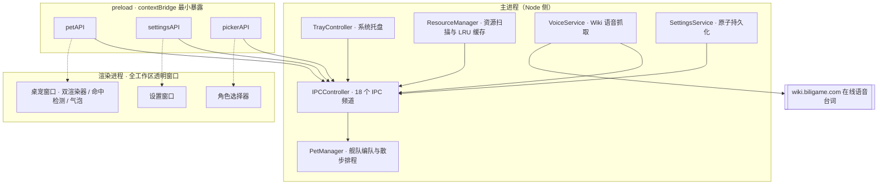

# 碧蓝航线桌宠 (blyy-pet)

<p align="center">
  <b>碧蓝航线 SD 小人 · Windows 11 桌面宠物</b><br>
  Electron 33 · Spine 3.8 · WebGL 批量渲染 · 逐像素鼠标穿透
</p>

碧蓝航线（Azur Lane）SD 小人桌宠：支持**舰队编队**（最多 3 只同屏）、**桌面散步**、**逐像素鼠标命中穿透**与**在线语音台词**。自研 Spine WebGL 批量渲染管线，实测每帧绘制 0.16ms，较 Canvas2D 提升约 **67 倍**。内置示例角色开箱即用，也可加载自备 SD 资源，覆盖 1500+ 舰娘。

> [!NOTE]
> 本仓库为**项目文档仓库**，仅包含说明文档与许可证，暂未公开源代码。

[](LICENSE)


---

## ✨ 功能一览

### 桌宠与交互

- **透明置顶显示** — Spine SD 小人驻留于桌面工作区，可选「始终前台」（`screen-saver` 级置顶，可覆盖全屏应用）。
- **逐像素鼠标命中** — 窗口透明区域点击直达下层程序，仅角色本体与台词气泡可交互；按光标下像素 alpha 滞回切换穿透状态，无死区也无误拦。
- **点击互动** — 左键点击随机播放动作与语音台词；拖动播放专属拖拽动画。
- **自由拖动** — 拖拽在画布内完成，窗口本身永不移动（见[渲染架构](#-渲染架构性能核心)）。
- **右键菜单** — 本体设置（播放动作/语音、缩放 0.5×–2.0×、切换角色、重载）+ 全局设置（始终前台 / 散步 / 穿透 / 开机自启）。

### 舰队编队与桌面散步

- **舰队编队** — 最多 **3** 只桌宠同屏，每只独立角色 / 皮肤 / 缩放 / 位置；在角色选择器内添加、移除成员或定向指派角色。
- **桌面散步** — 每 **1–3 分钟**随机触发一次，小人在屏幕内自然滑行约 2.6 秒（水平 180–420px、垂直浮动 ±48px）；最近一次交互后静默 30 秒，可全局开关。

### 语音与台词

- **在线语音台词** — 从碧蓝航线 Wiki（biligame）在线抓取台词与音频流式播放；皮肤目录内的本地音频（.mp3/.wav/.ogg）优先使用。
- **智能名称匹配** — VoiceMatcher 级联匹配「资源代码 ↔ 舰娘名」（精确 → 软/硬变体后缀 → 前缀 → 模糊子串 + 手动映射 + 多音字覆盖），**998 个舰名全量回归测试**保证不会播错人的语音（META / 改造 / μ兵装 等变体不回退到基础舰娘）。
- **多级缓存** — 内存 LRU（50 条）+ 磁盘缓存（上限 400 文件、7 天有效）+ 拼音映射表（30 天）；断网退避、并发去重，不重复请求。

### 窗口与韧性

- **角色选择器** — 1500+ 舰娘拼音 / ID 即时搜索（增量过滤，万级条目不卡顿），Enter 直达唯一结果。
- **设置窗口** — 缩放 / 语音 / 音量 / 自动播放 / 台词气泡 / 桌面散步 / 触摸穿透 / 始终前台 / 开机自启 / 资源目录，一应俱全。
- **显示器热插拔** — 移除或更改显示器后成员位置自动回迁主屏。
- **崩溃自恢复** — 渲染进程异常退出自动重载重建。
- **单实例锁** — 重复启动直接唤起已有桌宠，不重复驻留。

## 🎨 界面主题

「御窑青花」（明永乐·宣德青花瓷）主题：苏麻离青钴蓝色阶、甜白釉底色、朱砂警示红。设置窗口以纯 SVG 绘制瓶形外框、回纹饰带、海水江崖纹页脚；字体使用系统回退链，**零外部 CDN 依赖**，离线可用。

## 🚀 渲染架构（性能核心）

### 全工作区窗口 + 画布内移动

桌宠窗口覆盖所在显示器**整个工作区，创建后永不移动、永不缩放**；拖拽与散步都是移动画布内的小人。从根源上消除了 Electron 透明窗口高频 `setPosition` 与重绘交错导致的移动闪烁，桌面散步期间零窗口系统调用。

配合**帧级包围盒**（角色 ∪ 气泡矩形）约束清屏、scissor 与命中读取，GPU 带宽从整屏降至约 300×400 区域。

### 双渲染器管线

|  | WebGL 批量渲染（默认） | Canvas2D（回退） |
| --- | --- | --- |
| 绘制方式 | 整帧三角形合并 VBO/IBO，**个位数 draw call** | 逐三角形 `clip` + `drawImage`（600+ 次/帧） |
| 实测每帧绘制 | **0.156ms**（p95 0.3ms） | 10.4ms（p95 18.3ms），慢约 **67×** |
| 拼接缝 | GPU 三角形光栅化，共享边**天然无缝** | 亚像素外扩补偿（见下） |
| 混合 | PMA 预乘 alpha，4 种混合方程与官方 spine-webgl 3.8 一致 | — |

> 实测基准：635 三角形 SD 角色，`probe:seam --bench`（avg / p50 / p95 / max、draw call、三角形数全套统计）。

- **拼接缝修复**：Canvas2D 逐三角形 clip 的抗锯齿会在共享边两侧各留约半像素透明缝隙，深色立绘上呈白色网状裂纹。本项目的 Canvas2D 运行时增补了外扩补偿——网格内部共享边外扩 0.75px、轮廓边界外扩 0.5px（按设备像素换算），并限制尖锐针形三角形的位移上限、半透明期间自动停用，避免衍生黑边与闪线。
- **三级渲染兜底**：WebGL → SwiftShader 软件渲染（无 GPU 设备，仍显著快于 Canvas2D）→ Canvas2D。
- **帧率分层**：待机 / 散步 30fps，拖动与动作播放 60fps，兼顾功耗与流畅。

### 架构总览



## 🔒 安全设计

- 渲染进程 `contextIsolation: true`、`nodeIntegration: false`；三个窗口各自**最小化暴露** preload API。
- 设置写入**白名单**（15 个键）+ 类型 / 范围校验，防止渲染进程注入任意键、畸形值反复写盘。
- 资源文件读取限定在资源根目录内（路径归一化校验，防 `../` 逃逸）。
- CSP：`media-src` 仅放行 `https://*.biligame.com`，脚本与样式全部本地，无外部 CDN。
- 禁止 `window.open` 与任意页面导航；单实例锁。
- Wiki 抓取：响应体 16MB 上限（防压缩炸弹）、重定向拒绝跨域、25 秒超时、keep-alive 连接池。
- 设置文件**原子写入**（临时文件 + rename），异常断电不损坏配置。

## 📦 获取与使用

### 环境要求

- Windows 10 / 11（x64），针对 Windows 11 优化
- 打包版无需任何运行时依赖

### 使用步骤

1. 获取 `碧蓝航线桌宠-<版本号>-portable.exe`（Releases 附件，或按下一节自行构建）。
2. 双击运行 —— 内置示例角色「阿尔萨斯」**开箱即用**，无需任何配置。
3. 右键托盘图标 → 设置 → 选择 SD 资源目录，即可加载更多舰娘。
4. 右键桌宠本体或托盘图标，体验编队、散步、穿透等完整功能。

### SD 资源目录结构

与安卓端 blhx_sd 资源结构一致，每套皮肤为标准 Spine 三件套：

```
<你的资源目录>/
└── aersasi/                 # 舰娘拼音代码
    ├── default/             # 默认皮肤
    │   ├── aersasi.skel     # 骨骼数据
    │   ├── aersasi.atlas    # 图集描述
    │   └── aersasi.png      # 纹理图集
    ├── gai/                 # 改造皮肤
    ├── huan/                # 换装皮肤
    └── skin2/ … skin4/      # 其他编号皮肤
```

皮肤目录命名支持 `default` / `gai`（改造）/ `huan`（换装）/ `skin2`–`skin4` 等，文件名自动探测匹配。资源根解析优先级：用户指定目录 → 打包内置资源 → 开发目录 → 用户数据目录（自动创建）。

## 🛠️ 本地开发与构建

> 本仓库仅包含文档；以下为源码形态下的开发流程，供参考。

环境要求：Node.js ≥ 18、npm。

```bash
# 1. 安装依赖（国内网络建议设置镜像）
export ELECTRON_MIRROR=https://npmmirror.com/mirrors/electron/
npm install

# 2. 开发运行
npm start          # 正常启动
npm run dev        # 带控制台日志启动

# 3. 打包（输出 dist/碧蓝航线桌宠-<版本号>-portable.exe 与同名 zip）
export ELECTRON_CACHE="$PWD/.electron-cache"   # Electron 下载缓存收进项目内
npm run build

# 4. 打包国内镜像（electron-builder 二进制）
export ELECTRON_BUILDER_BINARIES_MIRROR=https://npmmirror.com/mirrors/electron-builder-binaries/
```

一键启动脚本：`start.bat`（双击运行，缺依赖时自动经国内镜像安装）、`start.ps1`（PowerShell 入口）、`launch.ps1`（隐藏窗口分离启动，日志写入 `launch.log`）。

## 🧪 测试与质量保障

- **`npm test`** — VoiceMatcher 全量回归：998 个 Wiki 舰名 × 1095 个资源代码快照，断言正确匹配 + 误配防护（赤城 不得命中 赤城·META / μ兵装 / 小赤城 等）。
- **六个端到端探针**（复用完整应用实例，断言日志、持久化与窗口状态）：

  | 探针 | 验证内容 |
  | --- | --- |
  | `probe:walk` | 散步期间窗口位置零移动、小人新位置正确持久化 |
  | `probe:fleet` | 编队成员添加 / 移除 / 定向指派的完整链路 |
  | `probe:hit` | 逐像素命中状态机：穿透↔交互可逆、拖动恒交互、气泡与菜单行为 |
  | `probe:voice` | 语音播放端到端：`play()` 无异常、气泡尺寸封顶 |
  | `probe:passthrough` | 全局触摸穿透开关与命中缓存失效 |
  | `probe:seam` | 渲染基准测试 + Canvas2D 外扩几何自测 |

## 📐 代码规模与技术栈

| 维度 | 说明 |
| --- | --- |
| 运行框架 | Electron 33 · Node.js ≥ 18 |
| 渲染 | Spine 3.8 运行时（vendored）+ 自研 WebGL 批量渲染器 |
| 第三方依赖 | **运行时 0 个**（仅 Node 内置模块）；devDependencies 仅 electron + electron-builder |
| 自有代码 | 约 10,500 行（src 31 个文件 19,143 行，其中官方 canvas 运行时 vendored 8,633 行） |
| 测试 | 9 个文件 1,591 行 + fixtures 2,093 行数据 |
| 打包 | electron-builder · asar · portable + zip（x64）· 内置资源约 3.9MB |

### 项目结构

```
src/
├── main/                 # 主进程
│   ├── index.js          # 入口：单例锁、启动编排、生命周期清理
│   ├── controllers/      # IPC 注册 / 系统托盘
│   ├── services/         # 设置持久化 / 资源扫描 / Wiki 语音
│   ├── windows/          # 桌宠 / 设置 / 角色选择器窗口管理
│   └── utils/            # 语音名称匹配 / 拼音表 / 图标生成
├── preload/              # contextBridge 最小暴露（三窗口各自独立 API）
├── renderer/
│   ├── pet/              # 桌宠窗口：双渲染器、命中检测、台词气泡
│   ├── settings/         # 设置窗口（御窑青花主题）
│   ├── character-picker/ # 角色选择器（增量过滤搜索）
│   └── vendor/           # Spine 3.8 canvas 运行时 + WebGL 批量渲染器
└── shared/constants.js   # 主/渲染进程共享常量（单一来源）
tests/                    # 端到端探针 + VoiceMatcher 回归测试
build/                    # 应用图标 + 内置示例角色资源
```

## ❓ 常见问题

- **语音和台词从哪里来？** 优先读取资源皮肤目录内的本地音频文件；没有本地文件时从碧蓝航线 Wiki 在线抓取，缓存 7 天。台词显示与音频完全来自官方 Wiki 公开内容。
- **某个角色没有语音，或播错了人？** 资源代码与 Wiki 舰名匹配失败或撞键时，可在 `userData/voice-aliases.json` 中手动指定「资源代码 → 汉字名」，保存即热生效。
- **为什么只有 Windows？** 逐像素鼠标穿透依赖 `setIgnoreMouseEvents({ forward: true })` 的事件转发能力，仅在该方案的 Windows 路径下可靠工作。
- **没有独立显卡的机器能跑吗？** 渲染管线自动回退：WebGL → SwiftShader 软件渲染 → Canvas2D，无 GPU 也能流畅运行。
- **能否自定义部署路径？** 支持环境变量 `BLYY_USER_DATA` 指定用户数据目录，便携部署友好。

## 📄 许可证与版权声明

- 项目代码以 [MIT](LICENSE) 许可发布。
- 碧蓝航线（Azur Lane）及相关名称、角色形象、美术资源之版权归 **蛮啾网络（Manjuu）、勇仕网络（Yongshi）与 Yostar** 所有。
- 本项目**不包含任何游戏资源文件**；Spine SD 资源需用户自行准备，仅供学习交流使用，请勿用于商业用途。
